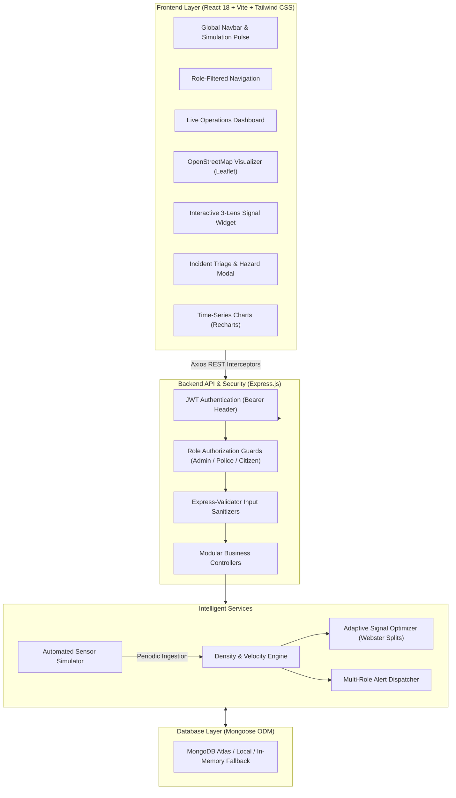

# 🚦 Smart Traffic Management System (STMS)

An intelligent, real-time traffic monitoring, incident triage, and adaptive signal optimization system developed as a **B.Tech Computer Science and Engineering** coursework capstone project.

[](file:///backend/tests)
[](https://github.com/Abhijeet356/Smart-Traffic-Management-System)
[](file:///frontend)
[](file:///backend)
[](https://www.mongodb.com/)

---

## 📌 Project Overview
Urban traffic congestion leads to substantial economic losses, increased carbon emissions, and severe delays for emergency transit. The **Smart Traffic Management System** delivers an end-to-end software solution that:
1. **Emulates IoT Sensor Telemetry:** Generates continuous stochastic vehicular influx, velocities, and capacities across urban grid intersections.
2. **Computes Dynamic Traffic Density:** Continuously analyzes saturation percentages using the formula:
   $$\text{Traffic Density (\%)} = \left(\frac{\text{Number of Vehicles}}{\text{Road Capacity}}\right) \times 100$$
   - **Low Traffic:** $0\% - 30\%$ (Green)
   - **Medium Traffic:** $31\% - 60\%$ (Yellow / Amber)
   - **High Traffic:** $61\% - 80\%$ (Orange)
   - **Severe Congestion:** $81\% - 100\%$ (Red / Pulsing)
3. **Adaptive Webster-Inspired Signal Optimization:** Dynamically balances green phase splits across intersection directional arms (North, South, East, West) proportionally to instantaneous queue density.
4. **Automated Anomaly & Hazard Detection:** Flags complete standstills (Speed $< 8\text{ km/h}$ & Density $\ge 75\%$), accidents, and lane obstructions.
5. **Role-Based Portals & Emergency Preemption:**
   - **Admin:** Global settings, user role provisioning, intersection registry.
   - **Traffic Police:** Live operations console, incident verification, emergency green corridor preemption.
   - **Citizen:** Interactive public map, traffic density advisories, crowdsourced incident reporting.

---

## 🏛️ System Architecture



---

## 📂 Repository Structure

```
Smart Traffic Management System/
├── backend/
│   ├── src/
│   │   ├── config/             # DB connection with in-memory fallback & constants
│   │   ├── controllers/        # Auth, Users, Locations, Traffic, Signals, Incidents, Alerts, Reports, Settings
│   │   ├── middleware/         # JWT Auth, Role-based guards, Validators, Error handler
│   │   ├── models/             # 10 Normalized Mongoose schemas (User, Location, TrafficData, TrafficSignal, SignalPlan, Incident, Alert, Notification, TrafficReport, SystemSettings)
│   │   ├── routes/             # RESTful API route modules
│   │   ├── seeds/              # Seed script with demo accounts & intersections
│   │   ├── services/           # Adaptive optimizer, density analyzer, simulator, alert dispatcher
│   │   ├── app.js              # Express app configuration & middlewares
│   │   └── server.js           # Server bootstrap & graceful shutdown
│   ├── tests/                  # 30 Automated tests (health, auth, admin, trafficEngine, integration)
│   ├── .env.example
│   └── package.json
│
├── frontend/
│   ├── src/
│   │   ├── components/         # DensityBadge, Navbar, Sidebar, StatCard, TrafficMap, SignalLightWidget, Modals
│   │   ├── context/            # AuthContext (JWT & roles), ThemeContext (Dark/Light)
│   │   ├── pages/              # Login, Register, Dashboard, LiveMap, Signals, Incidents, Intersections, Analytics, Users, Settings
│   │   ├── services/           # Axios client with auth interceptors
│   │   ├── App.jsx             # React Router with role guards
│   │   └── main.jsx
│   ├── vite.config.js
│   ├── tailwind.config.js
│   └── package.json
│
├── API_DOCUMENTATION.md        # Complete REST endpoint specifications & payloads
└── README.md                   # This documentation & viva guide
```

---

## 🚀 Step-by-Step Execution Guide

### Prerequisites
- **Node.js**: v18.0.0 or higher
- **npm**: v9.0.0 or higher
- **MongoDB**: *(Optional)* The backend automatically connects to local MongoDB or MongoDB Atlas if configured in `.env`. If no external database is detected, **it automatically falls back to an embedded in-memory MongoDB**, allowing 100% zero-configuration evaluation!

---

### Step 1: Install Dependencies

```bash
# In the backend directory:
cd backend
npm install

# In the frontend directory:
cd ../frontend
npm install
```

---

### Step 2: Seed Demo Data

Run the database seed script to populate realistic Delhi grid intersections, initial signal phase controllers, system settings, and role-based demonstration accounts:

```bash
cd backend
npm run seed
```

> **Pre-configured Demo Credentials:**
> - 👑 **Administrator:** `admin@traffic.gov` / `Password123!`
> - 👮 **Traffic Police Officer:** `officer.sharma@traffic.gov` / `Password123!`
> - 🚗 **Public Citizen:** `ananya.citizen@gmail.com` / `Password123!`
>
> *(Note: The login page also features **1-Click Quick Login buttons** for instant evaluation during viva!)*

---

### Step 3: Start the Backend Server

```bash
cd backend
npm run dev
```
- API Server runs at: `http://localhost:5000`
- System Healthcheck: `http://localhost:5000/api/health`

---

### Step 4: Start the Frontend Application

```bash
cd frontend
npm run dev
```
- Frontend Client runs at: `http://localhost:3000`

---

## 🧪 Running Automated Tests

The backend includes a comprehensive Jest and Supertest test suite with **30 automated tests**:

```bash
cd backend
npm test
```

### Test Coverage Highlights:
1. `tests/health.test.js`: Health check endpoints, system uptime, and 404 handler.
2. `tests/auth.test.js`: Registration, login validation, bcrypt password verification, JWT generation, and protected `/me` profile.
3. `tests/admin.test.js`: Role-based route enforcement, ensuring Citizens receive `403 Forbidden` on administrative actions.
4. `tests/trafficEngine.test.js`: Mathematical density calculations, threshold classifications, anomaly detection, and Webster proportional green-split allocations.
5. `tests/integration.test.js`: End-to-end multi-step lifecycle (Sensor telemetry ingestion $\rightarrow$ Congestion alert dispatch $\rightarrow$ Police alert acknowledgment $\rightarrow$ Resolution).

---

## 🎓 Academic Viva & Technical Defense Guide

When demonstrating this project to examiners, highlight the following design decisions:

### 1. Why Proportional (Webster-Inspired) Signal Timing?
- **Static Clocks vs. Dynamic Timing:** Traditional signals waste green time on empty lanes while cross-streets build queues.
- **The Algorithm:** Our `SignalOptimizer` computes the total green time available in a cycle:
  $$G_{\text{available}} = C - \sum (Y_i + L_i)$$
  It then distributes green seconds to each arm $i \in \{\text{North, South, East, West}\}$ based on instantaneous queue density:
  $$G_i = \max\left(G_{\min}, \min\left(G_{\max}, \frac{D_i}{\sum D_k} \times G_{\text{available}}\right)\right)$$
- **Starvation Prevention:** A strict $G_{\min} = 15\text{s}$ floor ensures pedestrians and low-traffic lanes are never perpetually blocked.

### 2. Why Leaflet & OpenStreetMap over Google Maps?
- **Open Standard:** Zero API keys or billing barriers required for academic evaluation.
- **Dynamic CircleMarkers:** Allows CSS-animated glowing pulses and color transitions as density changes in real time.

### 3. How Anomaly Detection Works
- When vehicles are detected at an intersection with velocity $< 8\text{ km/h}$ while density $> 75\%$, the rule engine flags an anomaly and dispatches a high-priority alert without waiting for human intervention.

### 4. Emergency Green Corridor Preemption
- Traffic police can override any signal via the UI (e.g. for ambulances or VIP movement), granting priority green time to a specific direction while locking cross-traffic to red, logged in `SignalPlan` audit history.

---

## 👥 Contributors & Academic Credits
- **Project:** Smart Traffic Management System (STMS)
- **Coursework:** B.Tech Computer Science and Engineering
- **GitHub Repository:** [Abhijeet356/Smart-Traffic-Management-System](https://github.com/Abhijeet356/Smart-Traffic-Management-System.git)
